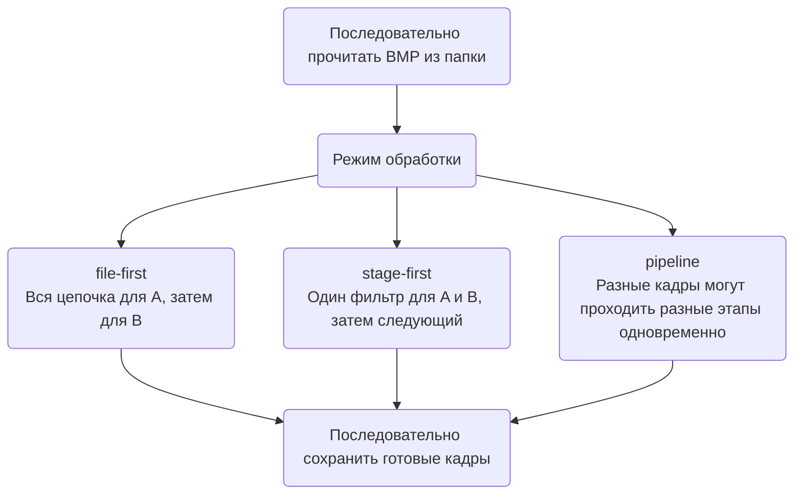

# Параллельная обработка изображений BMP

Проект по параллельному программированию на C++17. Программа читает и записывает несжатые 24-битные BMP собственным кодом. На одном кадре можно применить любой из пяти фильтров. При обработке папки все кадры проходят одну цепочку. Цель эксперимента — выяснить, как размер кадра, число потоков и порядок обработки влияют на время работы.

[Заявка на проект](Заявка_коллективный_проект.pdf) · [Отчёт](REPORT.md) · [Результаты экспериментов](results/RESULTS.md)

## Сборка и первый запуск

Команды выполняются из корня репозитория. В примере четыре потока выделяют контуры на готовом изображении и сохраняют результат в `edges.bmp`.

**Linux и WSL** — нужны GCC с поддержкой C++17 и Make.

```bash
make
./filter samples/input.bmp edges.bmp edges 4
```

**Windows** — нужны Visual Studio Build Tools с компонентом C++ и Windows SDK. В PowerShell:

```powershell
.\build.cmd
.\filter.exe samples\input.bmp edges.bmp edges 4
```

Для демонстрации всех фильтров выполните `./filter --demo` (в PowerShell — `.\filter.exe --demo`), затем откройте `samples/demo.html` в браузере.

## Фильтры

Для одного изображения команда принимает входной путь, выходной путь, имя фильтра и необязательное число потоков. По умолчанию используется один поток. Таблица также задаёт порядок этапов при обработке папки.

| Этап | Имя фильтра | Преобразование |
|---|---|---|
| 1 | `blur` / `размытие` | Среднее девяти значений каждого канала в окне 3×3. |
| 2 | `sharpen` / `резкость` | Центральное значение умножается на пять, затем вычитаются четыре прямых соседа. |
| 3 | `gray` / `серый` | Среднее трёх цветовых каналов записывается в каждый канал. |
| 4 | `exposure` / `экспозиция` | Экспозиция +1 EV удваивает значение каждого канала с ограничением до 255. |
| 5 | `edges` / `контуры` | Из восьмикратного значения центрального пикселя вычитается сумма восьми соседей по каждому каналу. |

На границе кадра для свёртки используется ближайший крайний пиксель. Результат ограничивается диапазоном 0–255.


Каждый из пяти фильтров применён отдельно к исходному кадру в левом верхнем углу.

## Три режима обработки папки

Следующая команда обрабатывает BMP из `samples` и сохраняет результаты под исходными именами. При повторном запуске укажите свежий выходной каталог. В PowerShell используйте `.\filter.exe` вместо `./filter`.

```bash
./filter --batch samples output-demo pipeline 4 --csv
```



Для двух кадров `A` и `B` порядок работы выглядит так:

| Режим | Как проходят этапы | Что делает один поток |
|---|---|---|
| `file-first` | Все пять фильтров для `A`, затем все пять для `B`. | Обрабатывает полосу строк текущего кадра. |
| `stage-first` | Размытие `A`, размытие `B`, затем резкость `A`, резкость `B` и так далее. | Обрабатывает полосу строк текущего кадра. |
| `pipeline` | Пока один поток повышает резкость `A`, другой может размывать `B`. | Применяет один фильтр ко всему кадру. |

В первых двух режимах потоки читают общий исходный кадр, записывают непересекающиеся полосы в отдельный буфер и завершают этап перед следующим фильтром. В конвейере работники берут из очереди пары «кадр, этап». При двух кадрах и восьми запрошенных потоках создаются два работника.

Для всех режимов программа сначала последовательно читает BMP из выбранного каталога без обхода подпапок, затем обрабатывает кадры в памяти и последовательно записывает результаты. Размер набора ограничен доступной оперативной памятью. Поддерживаются BMP с положительной высотой.

## Эксперименты и результаты

**Опубликованные измерения относятся к исходной цепочке из трёх фильтров** — размытие, резкость и перевод в серый. В текущей версии запускается цепочка из пяти фильтров. В опытах на одном кадре сравнивались Full HD и 4K при 1, 2, 4 и 8 потоках. В опыте на 100 кадрах 320×180 при восьми потоках медиана полного времени составила 0,386 с для `file-first`, 0,408 с для `stage-first` и 0,300 с для `pipeline`. [Таблицы, график и исходные данные](results/RESULTS.md)

Для собственного замера соберите программу и запустите команды в Bash на Linux, WSL или в Git Bash на Windows. Генератор, обработка результатов и тесты требуют Python 3.9+. Пример создаёт небольшой воспроизводимый набор и сравнивает все три режима.

```bash
python3 scripts/generate_dataset.py benchmark-data/batch100 --count 100 --width 320 --height 180
PYTHON=python3 REPEATS=3 THREADS="1 2 4 8" bash scripts/benchmark.sh benchmark-data/batch100
```

Если Python доступен под именем `python`, используйте его в первой команде и задайте `PYTHON=python` во второй. Путь к программе можно указать через `BINARY`. Для опыта на одном кадре создайте отдельный каталог с `--count 1` и размером 1920×1080 или 3840×2160.

Скрипт делает один прогрев каждой конфигурации. В каталоге `benchmark-output/run-*` сохраняются исходные измерения (`raw.csv`), сводка по повторам (`summary.csv`) и параметры запуска (`environment.txt`). База сравнения — медиана для `file-first` при одном потоке. Ускорение равно `T₁ / Tₚ`, эффективность — ускорению, делённому на число потоков.

В выводе `--csv` время указано в миллисекундах. `process_ms` охватывает фильтрацию, выделение буферов и работу потоков. В `total_ms` дополнительно входят чтение и запись. Повторные запуски используют файловый кеш ОС. Флаг `--cpu-csv` добавляет процессорное время всего цикла и этапа фильтрации.

## Устройство проекта

| Файл или каталог | Назначение |
|---|---|
| [main.cpp](main.cpp) | Разбор команд, проверка аргументов и вывод результатов. |
| [image.hpp](include/image.hpp), [bmp.cpp](src/bmp.cpp) | Кадр в памяти, чтение и запись BMP. |
| [filters.cpp](src/filters.cpp) | Применение одного фильтра и распределение строк между потоками. |
| [pipeline.cpp](src/pipeline.cpp) | Порядок выполнения этапов и очередь задач конвейера. |
| [batch.cpp](src/batch.cpp) | Обход каталога, запуск цепочки и измерение времени. |
| [demo.cpp](src/demo.cpp), [samples](samples/) | Генерация демонстрационных изображений и просмотр результатов. |
| [scripts](scripts/), [tests](tests/) | Генератор данных, сценарий измерений и попиксельные проверки. |

## Проверка корректности

После сборки выполните `python3 -m unittest discover -s tests -v` (в Windows — `python -m unittest discover -s tests -v`). Тесты сравнивают отдельные фильтры и полную цепочку с независимым расчётом на Python. Проверяются все три режима при 1, 2, 4 и 8 потоках, выравнивание строк BMP, обработка повреждённого файла и защита существующих результатов.
