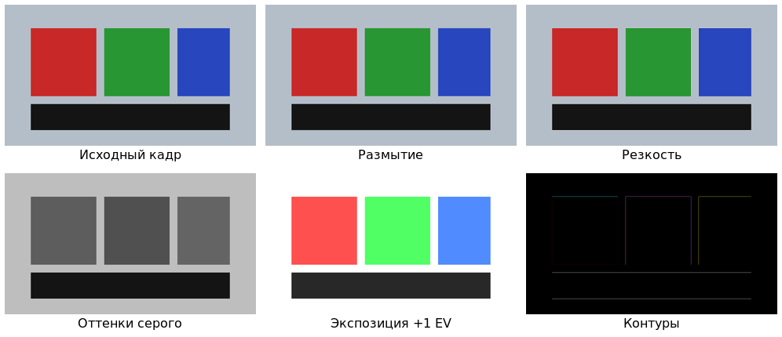
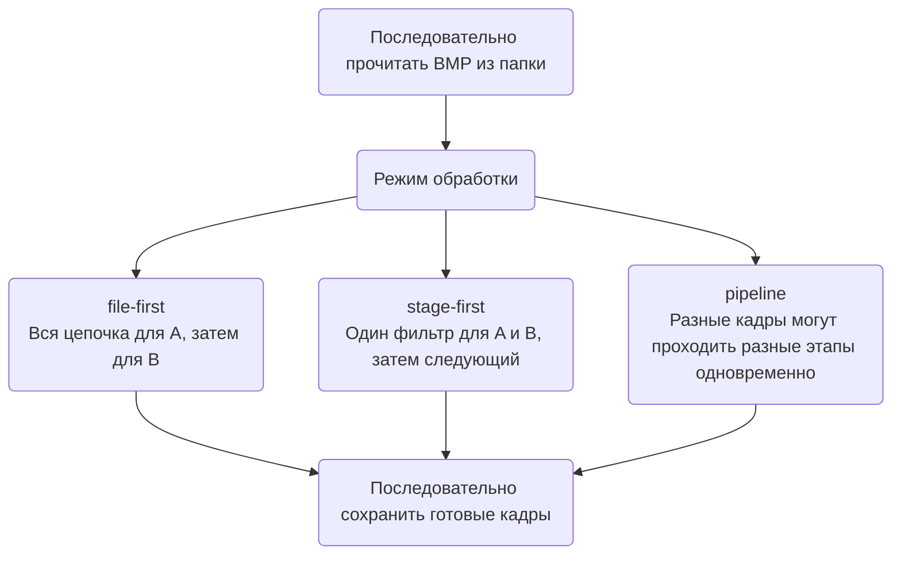
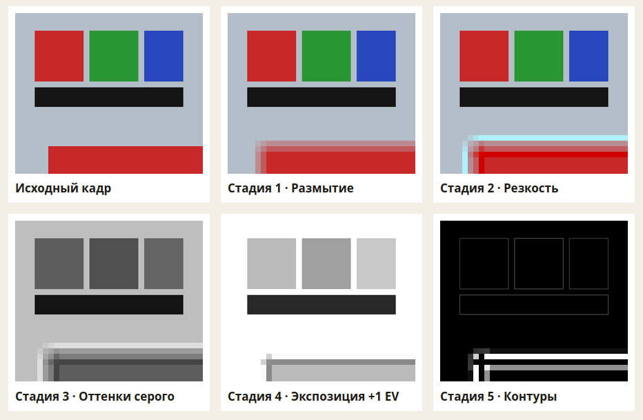
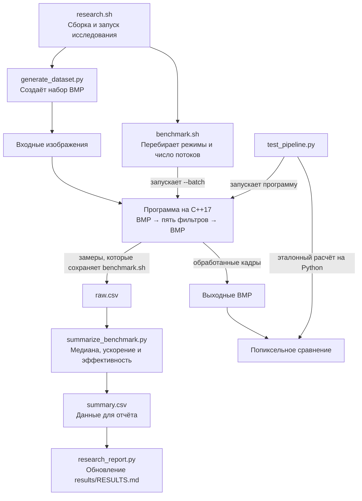

# Параллельная обработка изображений BMP

Цель проекта — исследовать, как размер изображения, число потоков и порядок обработки папки влияют на время выполнения цепочки фильтров. Для экспериментов реализована программа на C++17 с собственным чтением и записью несжатых 24-битных BMP. Для одних и тех же входных данных сравниваются последовательная и многопоточная обработка.

[Заявка на проект](Заявка_коллективный_проект.pdf) · [Отчёт](REPORT.md) · [Результаты экспериментов](results/RESULTS.md)

## Запуск полного исследования

Откройте терминал в корне репозитория (папке с `Makefile`). На Linux и в WSL нужны Bash, Make, G++ с поддержкой C++17 и Python 3.9+. На Windows откройте **Git Bash** в этой же папке. Для сборки нужны Visual Studio Build Tools с компонентом C++, Windows SDK и установленный Python 3.9+.

```bash
bash scripts/research.sh
```

Скрипт сам собирает программу, генерирует воспроизводимые изображения, выполняет один прогрев и серию измерений для каждой конфигурации. Таблицы выводятся прямо в терминал. После успешного завершения обновляется [results/RESULTS.md](results/RESULTS.md) с таблицами, графиком и выводами по этому запуску. Дробные значения времени и ускорения форматирует Python независимо от десятичного разделителя системы. Отдельная команда `awk` не требуется.

| Опыт | Что сравнивается | Какое время попадает в отчёт |
|---|---|---|
| Папка из 100 кадров 320×180 | Режимы `file-first`, `stage-first` и `pipeline` на одном наборе при 1, 2, 4 и 8 потоках | Полный цикл обработки папки, включая чтение и запись |
| Один кадр Full HD и один кадр 4K | Обработка по строкам в режиме `file-first` при тех же числах потоков для каждого разрешения | Время фильтрации кадра всей цепочкой из пяти фильтров |

### Настройки эксперимента

Для изменения условий отредактируйте [scripts/research.conf](scripts/research.conf) и повторите команду запуска.

| Параметр | По умолчанию | Назначение |
|---|---|---|
| `THREADS` | `"1 2 4 8"` | Числа запрашиваемых потоков. Для расчёта ускорения список должен включать 1. |
| `REPEATS` | `3` | Число измерений после одного прогрева каждой конфигурации. |
| `BATCH_COUNT`, `BATCH_WIDTH`, `BATCH_HEIGHT` | `100`, `320`, `180` | Число кадров в папке и размер каждого кадра в пикселях. |
| `FRAME_SIZES` | `"1920x1080 3840x2160"` | Разрешения для опыта с одиночным кадром. |
| `SEED` | `42` | Начальное значение генератора для воспроизведения входных данных. |
| `MEASURE_CPU` | `1` | Включает измерение процессорного времени. Значение `0` оставляет только измерение времени по часам. |

### Как читать результаты

Время в таблице — медиана повторов в миллисекундах. Ускорение рассчитывается относительно `file-first` с одним потоком на том же наборе и для того же интервала. Например, `2.5×` означает, что время сократилось в 2,5 раза. Эффективность равна ускорению, делённому на запрошенное число потоков.

Модель процессора и число логических CPU определяются автоматически. При `MEASURE_CPU=1` программа делит суммарное процессорное время своих потоков на длительность измеряемого интервала. Значение **3.25** в столбце «Занято логических CPU» означает, что в среднем за этот интервал программа использовала эквивалент 3,25 логического процессора. В итоговой таблице приведена медиана таких значений по повторам.

В `results/runs/` для каждого запуска создаётся отдельная папка с копией настроек и данными каждого опыта: `raw.csv` содержит исходные измерения, `summary.csv` — сводку, `environment.txt` — параметры окружения. Предыдущие запуски сохраняются. Исходное исследование цепочки из трёх фильтров доступно в [архивном отчёте](results/RESULTS-3-filters.md).

## Фильтры

Для одного изображения команда принимает входной путь, выходной путь, имя фильтра и необязательное число потоков. По умолчанию используется один поток. Таблица также задаёт порядок этапов при обработке папки.

| Этап | Имя фильтра | Преобразование |
|---|---|---|
| 1 | `blur` / `размытие` | Среднее девяти значений каждого канала в окне 3×3. |
| 2 | `sharpen` / `резкость` | Центральное значение умножается на пять, затем вычитаются четыре прямых соседа. |
| 3 | `gray` / `серый` | Среднее трёх цветовых каналов записывается в каждый канал. |
| 4 | `exposure` / `экспозиция` | Экспозиция +1 EV удваивает значение каждого канала с ограничением до 255. |
| 5 | `edges` / `контуры` | Из восьмикратного значения центрального пикселя вычитается сумма восьми соседей по каждому каналу. |

На границе кадра для свёртки используется ближайший крайний пиксель. Результат ограничивается диапазоном 0–255.



Каждый из пяти фильтров применён отдельно к исходному кадру в левом верхнем углу.

## Три режима обработки папки

Следующая команда обрабатывает BMP из `samples` и сохраняет результаты под исходными именами. При повторном запуске укажите свежий выходной каталог. В PowerShell используйте `.\filter.exe` вместо `./filter`.

```bash
./filter --batch samples output-demo pipeline 4 --csv
```



Для двух кадров `A` и `B` порядок работы выглядит так:

| Режим | Как проходят этапы | Что делает один поток |
|---|---|---|
| `file-first` | Все пять фильтров для `A`, затем все пять для `B`. | Обрабатывает полосу строк текущего кадра. |
| `stage-first` | Размытие `A`, размытие `B`, затем резкость `A`, резкость `B` и так далее. | Обрабатывает полосу строк текущего кадра. |
| `pipeline` | Пока один поток повышает резкость `A`, другой может размывать `B`. | Применяет один фильтр ко всему кадру. |

В первых двух режимах потоки читают общий исходный кадр, записывают непересекающиеся полосы в отдельный буфер и завершают этап перед следующим фильтром. В конвейере работники берут из очереди пары «кадр, этап». При двух кадрах и восьми запрошенных потоках создаются два работника.

Для всех режимов программа сначала последовательно читает BMP из выбранного каталога без обхода подпапок, затем обрабатывает кадры в памяти и последовательно записывает результаты. Размер набора ограничен доступной оперативной памятью. Поддерживаются BMP с положительной высотой.

### Как меняется кадр после каждой стадии

Каждая стадия получает результат предыдущей. Для одного и того же исходника все три режима (`file-first`, `stage-first` и `pipeline`) сохраняют одинаковый итоговый BMP — кадр пятой стадии «Контуры», показанный внизу справа. Полоса под каждым кадром увеличивает фрагмент границы для сравнения.



## Устройство проекта

| Файл или каталог | Назначение |
|---|---|
| [main.cpp](main.cpp) | Разбор команд, проверка аргументов и вывод результатов. |
| [image.hpp](include/image.hpp), [bmp.cpp](src/bmp.cpp) | Кадр в памяти, чтение и запись BMP. |
| [filters.cpp](src/filters.cpp) | Применение одного фильтра и распределение строк между потоками. |
| [pipeline.cpp](src/pipeline.cpp) | Порядок выполнения этапов и очередь задач конвейера. |
| [batch.cpp](src/batch.cpp) | Обход каталога, запуск цепочки и измерение времени. |
| [demo.cpp](src/demo.cpp), [samples](samples/) | Генерация демонстрационных изображений и просмотр результатов. |
| [scripts](scripts/), [tests](tests/) | Генератор данных, сценарий измерений и попиксельные проверки. |

### Архитектура проекта



## Дополнительно: ручной запуск и демо

Команды выполняются из корня репозитория. В примере четыре потока выделяют контуры на готовом изображении и сохраняют результат в `edges.bmp`.

**Linux и WSL** — нужны GCC с поддержкой C++17 и Make.

```bash
make
./filter samples/input.bmp edges.bmp edges 4
```

**Windows** — нужны Visual Studio Build Tools с компонентом C++ и Windows SDK. В PowerShell:

```powershell
.\build.cmd
.\filter.exe samples\input.bmp edges.bmp edges 4
```

Для демонстрации всех фильтров выполните `./filter --demo` (в PowerShell — `.\filter.exe --demo`), затем откройте `samples/demo.html` в браузере.

## Проверка корректности

После сборки выполните `python3 -m unittest discover -s tests -v` (в Windows — `python -m unittest discover -s tests -v`). Тесты сравнивают отдельные фильтры и полную цепочку с независимым расчётом на Python. Проверяются все три режима при 1, 2, 4 и 8 потоках, выравнивание строк BMP, обработка повреждённого файла и защита существующих результатов.
