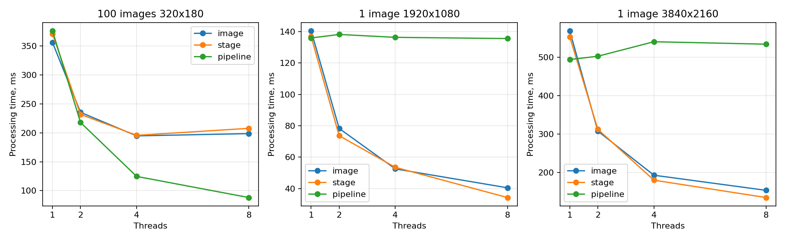

# ?????????? ?????????????

18.11.2026. Windows, Intel Core i5-11300H: 4 ????, 8 ?????????? ???????????.
?????? MSVC, C++17, /O2. Seed ?????????? 42. ???? ??????? ? ??? ?????????.
?? ???? ?????? ??????????? ??????? blur ? sharpen ? gray. ????? ? ???????.

???? ?????????: image, ???? ?????, ?? ??? ?? ??????. ????? ? ?????????????.

## 100 images 320x180

[???????? ??????](batch100/raw.csv), [??????? ???????](batch100/summary.csv), [?????????](batch100/environment.txt).

| ????? | ?????? | ??????????, ?? | ????????? ?????????? | ????????????? | ? ??????, ?? | ????????? ? ?????? |
|---|---:|---:|---:|---:|---:|---:|
| image | 1 | 356.315 | 1.0 | 1.0 | 539.678 | 1.0 |
| image | 2 | 235.419 | 1.5135 | 0.7568 | 418.961 | 1.2881 |
| image | 4 | 194.763 | 1.8295 | 0.4574 | 374.55 | 1.4409 |
| image | 8 | 198.656 | 1.7936 | 0.2242 | 385.89 | 1.3985 |
| stage | 1 | 371.285 | 0.9597 | 0.9597 | 569.138 | 0.9482 |
| stage | 2 | 231.833 | 1.5369 | 0.7685 | 469.234 | 1.1501 |
| stage | 4 | 195.678 | 1.8209 | 0.4552 | 383.412 | 1.4076 |
| stage | 8 | 207.781 | 1.7149 | 0.2144 | 408.151 | 1.3223 |
| pipeline | 1 | 376.334 | 0.9468 | 0.9468 | 562.812 | 0.9589 |
| pipeline | 2 | 217.919 | 1.6351 | 0.8175 | 420.339 | 1.2839 |
| pipeline | 4 | 124.678 | 2.8579 | 0.7145 | 324.338 | 1.6639 |
| pipeline | 8 | 88.124 | 4.0433 | 0.5054 | 299.834 | 1.7999 |

## 1 image 1920x1080

[???????? ??????](fullhd/raw.csv), [??????? ???????](fullhd/summary.csv), [?????????](fullhd/environment.txt).

| ????? | ?????? | ??????????, ?? | ????????? ?????????? | ????????????? | ? ??????, ?? | ????????? ? ?????? |
|---|---:|---:|---:|---:|---:|---:|
| image | 1 | 140.551 | 1.0 | 1.0 | 163.665 | 1.0 |
| image | 2 | 78.306 | 1.7949 | 0.8974 | 99.285 | 1.6484 |
| image | 4 | 52.533 | 2.6755 | 0.6689 | 71.259 | 2.2968 |
| image | 8 | 40.481 | 3.472 | 0.434 | 64.85 | 2.5237 |
| stage | 1 | 136.901 | 1.0267 | 1.0267 | 163.944 | 0.9983 |
| stage | 2 | 73.657 | 1.9082 | 0.9541 | 97.299 | 1.6821 |
| stage | 4 | 53.53 | 2.6256 | 0.6564 | 72.407 | 2.2603 |
| stage | 8 | 34.251 | 4.1036 | 0.5129 | 53.871 | 3.0381 |
| pipeline | 1 | 135.998 | 1.0335 | 1.0335 | 157.586 | 1.0386 |
| pipeline | 2 | 138.24 | 1.0167 | 0.5084 | 160.455 | 1.02 |
| pipeline | 4 | 136.401 | 1.0304 | 0.2576 | 158.172 | 1.0347 |
| pipeline | 8 | 135.628 | 1.0363 | 0.1295 | 156.658 | 1.0447 |

## 1 image 3840x2160

[???????? ??????](4k/raw.csv), [??????? ???????](4k/summary.csv), [?????????](4k/environment.txt).

| ????? | ?????? | ??????????, ?? | ????????? ?????????? | ????????????? | ? ??????, ?? | ????????? ? ?????? |
|---|---:|---:|---:|---:|---:|---:|
| image | 1 | 569.175 | 1.0 | 1.0 | 638.683 | 1.0 |
| image | 2 | 307.595 | 1.8504 | 0.9252 | 376.356 | 1.697 |
| image | 4 | 192.452 | 2.9575 | 0.7394 | 260.693 | 2.4499 |
| image | 8 | 152.993 | 3.7203 | 0.465 | 225.271 | 2.8352 |
| stage | 1 | 553.346 | 1.0286 | 1.0286 | 628.89 | 1.0156 |
| stage | 2 | 312.233 | 1.8229 | 0.9115 | 387.669 | 1.6475 |
| stage | 4 | 179.493 | 3.171 | 0.7928 | 243.659 | 2.6212 |
| stage | 8 | 134.176 | 4.242 | 0.5303 | 196.573 | 3.2491 |
| pipeline | 1 | 494.26 | 1.1516 | 1.1516 | 562.157 | 1.1361 |
| pipeline | 2 | 502.84 | 1.1319 | 0.566 | 568.873 | 1.1227 |
| pipeline | 4 | 540.727 | 1.0526 | 0.2632 | 611.628 | 1.0442 |
| pipeline | 8 | 534.311 | 1.0653 | 0.1332 | 606.671 | 1.0528 |

## ??? ?????? ??????????

?? ????? ??????????? ???????? ?? ????? ???????????? ????????? ????????? ?????. ??????? ???????? ??????? ? pipeline ????? ?? ???? ?????????. ??? ?????? ????? ??????? ??????? ????? ? image/stage.

??? ????? ???????? ?????????? ????????????? ???????????. ?? ????????? ?????? ?? ????? ????????? ??????? ?? ?????????? ???????? ??????? ??? ??????? ???????. ????? ????? ????? ??? ????????? ???? ???????? ???????.

??? ??????????????? ??????????. ??? ?????? ?????? ?? ?????? Full HD/4K ????? ????????? ????????? ???????????? ?? ???? ???????. ????????? ??????? ? ???? ????? ?? ????????.

Дополнительный опыт на 100 BMP при 1 и 8 потоках описан в [разделе отчёта о загрузке CPU](../REPORT.md#загрузка-cpu-при-обработке-папки). [Исходные данные](batch100/cpu.csv).
