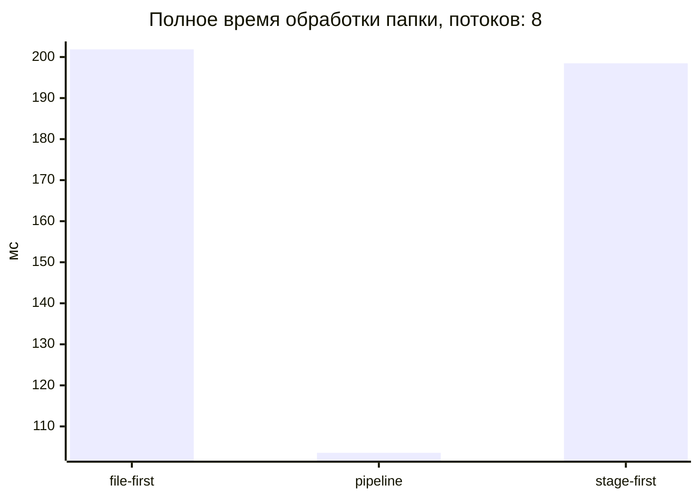

# Результаты исследования

2026-11-19 00:14 MSK · Linux · AMD Ryzen 5 7535HS with Radeon Graphics · логических CPU в системе: 12.

Цепочка: размытие → резкость → серый → экспозиция → контуры.
Синтетические BMP, seed 42. Один прогрев и 3 измерения для каждой конфигурации.
Время — медиана. База ускорения — file-first с одним потоком на том же наборе. Эффективность равна ускорению, делённому на число запрошенных потоков.

## Папка: 100 кадров 320x180, полный цикл

| Режим | Потоки | Время, мс | Ускорение | Эффективность | Занято логических CPU |
|---|---:|---:|---:|---:|---:|
| file-first | 1 | 613.817 | 1.000× | 1.000 | 1.00 |
| file-first | 2 | 291.077 | 2.109× | 1.054 | 1.66 |
| file-first | 4 | 174.356 | 3.521× | 0.880 | 2.74 |
| file-first | 8 | 201.876 | 3.041× | 0.380 | 3.43 |
| pipeline | 1 | 409.478 | 1.499× | 1.499 | 1.00 |
| pipeline | 2 | 230.519 | 2.663× | 1.331 | 1.84 |
| pipeline | 4 | 131.707 | 4.660× | 1.165 | 3.21 |
| pipeline | 8 | 103.559 | 5.927× | 0.741 | 5.56 |
| stage-first | 1 | 422.639 | 1.452× | 1.452 | 1.00 |
| stage-first | 2 | 336.551 | 1.824× | 0.912 | 1.61 |
| stage-first | 4 | 175.128 | 3.505× | 0.876 | 2.71 |
| stage-first | 8 | 198.470 | 3.093× | 0.387 | 3.29 |

Минимальная медиана: pipeline, потоков: 8, 103.559 мс.

[Все измерения](runs/run-J4py2cyI/batch/raw.csv) · [Сводка](runs/run-J4py2cyI/batch/summary.csv) · [Окружение](runs/run-J4py2cyI/batch/environment.txt)

## Один кадр 1920x1080, фильтрация

| Режим | Потоки | Время, мс | Ускорение | Эффективность | Занято логических CPU |
|---|---:|---:|---:|---:|---:|
| file-first | 1 | 141.349 | 1.000× | 1.000 | 1.00 |
| file-first | 2 | 77.831 | 1.816× | 0.908 | 1.85 |
| file-first | 4 | 45.612 | 3.099× | 0.775 | 3.18 |
| file-first | 8 | 42.191 | 3.350× | 0.419 | 4.76 |

Минимальная медиана: file-first, потоков: 8, 42.191 мс.

[Все измерения](runs/run-J4py2cyI/1920x1080/raw.csv) · [Сводка](runs/run-J4py2cyI/1920x1080/summary.csv) · [Окружение](runs/run-J4py2cyI/1920x1080/environment.txt)

## Один кадр 3840x2160, фильтрация

| Режим | Потоки | Время, мс | Ускорение | Эффективность | Занято логических CPU |
|---|---:|---:|---:|---:|---:|
| file-first | 1 | 565.458 | 1.000× | 1.000 | 1.00 |
| file-first | 2 | 316.933 | 1.784× | 0.892 | 1.85 |
| file-first | 4 | 179.684 | 3.147× | 0.787 | 3.25 |
| file-first | 8 | 172.150 | 3.285× | 0.411 | 4.81 |

Минимальная медиана: file-first, потоков: 8, 172.15 мс.

[Все измерения](runs/run-J4py2cyI/3840x2160/raw.csv) · [Сводка](runs/run-J4py2cyI/3840x2160/summary.csv) · [Окружение](runs/run-J4py2cyI/3840x2160/environment.txt)

[Архив опытов с тремя фильтрами](RESULTS-3-filters.md)
